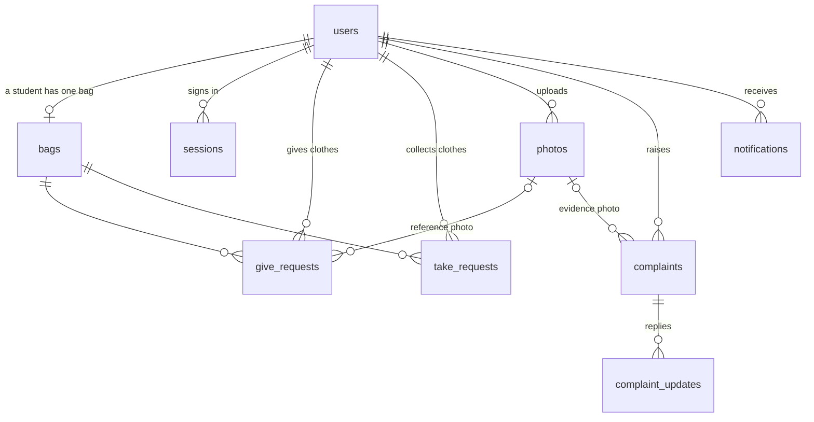

# Database requirements

The RU Laundry System uses **PostgreSQL** (version 14 or newer).
All tables are created by [`schema.sql`](schema.sql). Demo data is in [`seed.js`](seed.js).

```bash
createdb ru_laundry        # make an empty database
npm run db:setup           # create the tables and load the demo data
```

## How the tables connect



`activity`, `counter_state`, `counter_schedule` and `counter_closures` stand on their own.

## The tables

| Table | One row is... | Key columns |
|---|---|---|
| `users` | a student, worker or admin | `id` is what they type to sign in (`RU2026CS001`, `W-001`, `admin`). `role` is `STUDENT`, `WORKER` or `ADMIN`. Passwords are stored only as bcrypt hashes. |
| `sessions` | a signed in browser | `token_hash` (SHA-256 of the random token, never the token itself), `user_id`, `expires_at` (7 days) |
| `bags` | a student's permanent bag | `bag_number` (`B-001`), `student_id` (**unique**: one bag per student), `status`, `quantity`, `service` (`regular`/`urgent`/`ironing`), `ironing`, `progress` (the washing step), `due_at` (when it should be ready), `received_by`, `returned_by` |
| `photos` | an uploaded picture | `student_id` (the owner), `kind` (`REFERENCE` or `COMPLAINT_EVIDENCE`), `data_url` |
| `give_requests` | one "Give Clothes" | `status` `PENDING` → `RECEIVED` (or `EXPIRED`/`CANCELLED`), `qr_expires_at`, `scanned_at`, `confirmed_quantity`, `service`, `ironing`, `code` (the short code the worker types), `seen` |
| `take_requests` | one "Take Clothes" | `status` `PENDING` → `SCANNED` → `VERIFIED` → `COMPLETED` (or `EXPIRED`/`CANCELLED`), `session_expires_at`, `service`, `ironing`, `code`, `seen`, `give_request_id` (the submission it belongs to) |
| `activity` | one line of the audit history | `action`, who did it, the bag, `from_status` → `to_status`, `reason`, link to the request (`ref_type`, `ref_id`) |
| `complaints` | one complaint | `ref` (`CMP-2026-0001`), `category`, `status`, `assigned_to`, `resolution` |
| `complaint_updates` | one reply on a complaint | `complaint_ref`, `author_name`, `body` |
| `notifications` | one message in a student's bell | `student_id`, `title`, `body`, `read` |
| `counter_state` | always exactly one row | `manual_state`: `OPEN` / `CLOSED` (admin pressed the button) or empty (the schedule decides) |
| `counter_schedule` | one day of the week | `is_open`, `open_time`, `close_time` (like `08:00`) |
| `counter_closures` | a holiday or a temporary closure | `type`, `date`, `start_time`, `end_time`, `reason` |
| `settings` | the settings of the laundry (always one row) | `urgent_enabled` (false switches the one-day urgent service off) |

## The rules, and how the database keeps them

| Rule | How it is enforced |
|---|---|
| Only three bag statuses | `CHECK (status IN ('NOT_GIVEN', 'IN_PROCESS', 'AT_COUNTER'))` on `bags` |
| One permanent bag per student | `bags.student_id` is `UNIQUE` |
| One open Give request and one open Take request per student | two partial unique indexes (`one_open_give_per_student`, `one_open_take_per_student`) |
| 1 to 15 clothes per submission | `CHECK (quantity BETWEEN 1 AND 15)` on `give_requests` |
| Only the three services | `CHECK (service IN ('regular', 'urgent', 'ironing'))` on `bags` and on both request tables |
| Every short code is different | `UNIQUE` on `code` in `give_requests` and `take_requests` |
| One request at a time | the partial unique indexes `one_open_give_per_student` and `one_open_take_per_student` |
| The activity history is never changed or deleted | two rules on `activity` turn any `UPDATE` or `DELETE` into "do nothing" |
| Complaint statuses are separate from bag statuses | their own `CHECK` list on `complaints.status` |
| The reference photo is private | `photos.student_id` records the owner. The only route that returns a reference photo checks `student_id` = the signed in student. No worker or admin route reads `REFERENCE` photos. |
| Passwords are never stored | only `password_hash` (bcrypt) |
| Login tokens are never stored | only `sessions.token_hash` (SHA-256). A copy of the database cannot be used to sign in. |

## Sizes and growth

For one university counter (about 1,000 students, two laundry cycles a week):

- `give_requests` / `take_requests`: about 100,000 rows a year each
- `activity`: about 5 lines per cycle, so about 500,000 rows a year
- `photos`: the biggest table. Each photo can be up to about 4 MB. If many students upload
  photos, move them to file storage (for example S3) and keep only the address in `data_url`.

The list screens load rows and filter them in JavaScript (see `src/filters.js`) to keep the
SQL simple. If the history gets very large, move the filters into the SQL `WHERE`.

## Backups

The `activity` table is the official record of every bag movement. Back up the database every
day, for example:

```bash
pg_dump ru_laundry > backup-$(date +%F).sql
```
